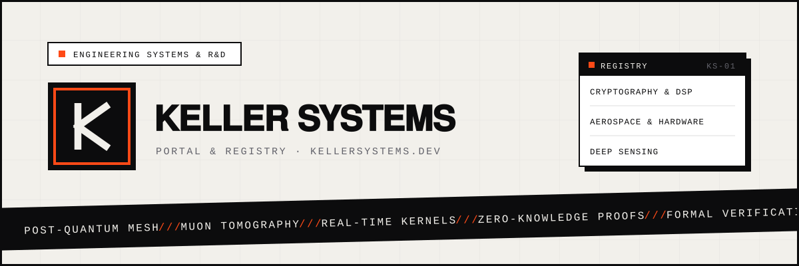

<div align="center">



<br>

[](https://kellersystems.dev)
[](https://kellersystems.dev#featured)
[](https://kellersystems.dev#all-work)
[](https://github.com/KELLERBABG)

<br>

[**Live Portal &rarr;**](https://kellersystems.dev) &bull; [**Featured Systems**](https://kellersystems.dev#featured) &bull; [**Repository Directory**](https://kellersystems.dev#all-work) &bull; [**GitHub Profile**](https://github.com/KELLERBABG)

</div>

---

## Overview

**Keller Systems** is an independent systems engineering and research portal focused on deterministic computation, cryptographic sovereignty, high-assurance embedded runtimes, and novel physical instrumentation.

Every system indexed here features dedicated domain routing, reproducible builds, and verified source distributions.

---

## Core Focus Areas

```
                     ┌──────────────────────────────┐
                     │        KELLER SYSTEMS        │
                     │      kellersystems.dev       │
                     └──────────────┬───────────────┘
                                    │
       ┌────────────────────────────┼────────────────────────────┐
       ▼                            ▼                            ▼
┌──────────────┐             ┌──────────────┐             ┌──────────────┐
│ Cryptography │             │  Aerospace   │             │ Deep Sensing │
│   & Proofs   │             │  & Hardware  │             │ & Harvesting │
├──────────────┤             ├──────────────┤             ├──────────────┤
│ • Post-quant │             │ • Micro-SAR  │             │ • Muon tomog │
│ • Dual-band  │             │ • Real-time  │             │ • Wildfire PM│
│   stego DSP  │             │   avionics   │             │ • Atmospheric│
│ • Zero-DRM   │             │ • Fault-tol. │             │   energy harv│
└──────────────┘             └──────────────┘             └──────────────┘
```

* **Deterministic Systems & Cryptography:** Audio steganography, zero-knowledge proofs, and post-quantum communication fabrics.
* **Aerospace & Physical Computing:** Low-Earth orbit micro-SAR payload controllers, radiation-tolerant telemetry kernels, and drone telemetry ledgers.
* **Deep Sensing & Harvesters:** Real-time atmospheric resonance harvesters, thermodynamic water generators, and environmental exposure trackers.

---

## Flagship Architectures

| System | Domain | Description | Stack | Live Subdomain | Repository |
| :--- | :--- | :--- | :--- | :--- | :--- |
| **Vantablack** | Cryptography & ZK | Post-quantum decentralized WAN mesh network with erasure-sharded onion routing | `Rust` `Tokio` `ML-KEM-768` | [vantablack.kellersystems.dev](https://vantablack.kellersystems.dev) | [Vantablack](https://github.com/KELLERBABG/Vantablack) |
| **BauLens** | Compliance & Civil | Deterministic German and EU building code compliance validation engine | `JavaScript` `TypeScript` `IFC` | [lens.kellersystems.dev](https://lens.kellersystems.dev) | [BauLens](https://github.com/KELLERBABG/BauLens) |
| **ClauseLens** | LegalTech & SMT | Automated contract clause contradiction and risk scoring engine | `JavaScript` `Deontic Logic` | [clause.kellersystems.dev](https://clause.kellersystems.dev) | [LexiClear](https://github.com/KELLERBABG/LexiClear) |
| **Ambient Thermal Arbitrage** | Thermodynamics & Energy | Ambient Thermal Arbitrage and virtual battery energy management system | `Rust` `Thermodynamics` `MPC` | [ambient.kellersystems.dev](https://ambient.kellersystems.dev) | [Ambient-Thermal-Arbitrage](https://github.com/KELLERBABG/Ambient-Thermal-Arbitrage) |
| **HoloForge** | Volumetric 3D Printing | Holographic tomographic volumetric 3D printing suite (Tomo-H-VAM) | `Python` `Wave Optics` | [github.com/KELLERBABG/HoloForge](https://github.com/KELLERBABG/HoloForge) | [HoloForge](https://github.com/KELLERBABG/HoloForge) |

---

## Complete Systems Directory (All 35 Projects)

### Cryptography, Privacy & Zero-Knowledge

| System | Description | Language | Live Deployment | Source |
| :--- | :--- | :--- | :--- | :--- |
| **Vantablack** | Post-quantum decentralized WAN mesh network with erasure-sharded onion routing | `Rust` | [vantablack.kellersystems.dev](https://vantablack.kellersystems.dev) | [GitHub &rarr;](https://github.com/KELLERBABG/Vantablack) |
| **Quantum Entanglement Link** | Quantum communication network simulation stack: density-matrix states and noise, QKD and repeater routing | `Python` | [kellerbabg.github.io/QEL](https://kellerbabg.github.io/QEL/) | [GitHub &rarr;](https://github.com/KELLERBABG/QEL) |
| **SybilGuard** | Zero-knowledge Sybil-resistant Proof-of-Personhood biometric protocol | `Rust` | [citadel.kellersystems.dev](https://citadel.kellersystems.dev) | [GitHub &rarr;](https://github.com/KELLERBABG/SybilGuard) |
| **Planetary Entropy Mining** | Environmental noise capture with zero-knowledge proof of honest capture hiding node location | `Python` | [pem.kellersystems.dev](https://pem.kellersystems.dev) | [GitHub &rarr;](https://github.com/KELLERBABG/Planetary-Entropy-Mining) |
| **SMPC Dark Pool** | Secure Multi-Party Computation Dark Pool with differential privacy guarantees | `Rust` | [enclave.kellersystems.dev](https://enclave.kellersystems.dev) | [GitHub &rarr;](https://github.com/KELLERBABG/SMPC-Dark-Pool) |
| **Homomorphic Database** | Homomorphic Encrypted Database (FHE-DB): Relational queries on ciphertext | `Rust` | [fhe.kellersystems.dev](https://fhe.kellersystems.dev) | [GitHub &rarr;](https://github.com/KELLERBABG/Homomorphic-Database) |
| **Zero Knowledge Genome** | Private biological sequence matching and genomic zero-knowledge proofs | `Rust` | [zkg.kellersystems.dev](https://zkg.kellersystems.dev) | [GitHub &rarr;](https://github.com/KELLERBABG/Zero-Knowledge-Genome) |
| **SymEx EVM** | Symbolic execution engine for EVM bytecode vulnerability detection and SMT verification | `Rust` | [axiom.kellersystems.dev](https://axiom.kellersystems.dev) | [GitHub &rarr;](https://github.com/KELLERBABG/SymEx-EVM) |
| **TradeShield** | Zero-fraud DEX wash-trading detector and volume integrity ledger | `TypeScript` | [trade.kellersystems.dev](https://trade.kellersystems.dev) | [GitHub &rarr;](https://github.com/KELLERBABG/TradeShield) |
| **Differential Privacy Synthesizer** | Differential Privacy Synthesizer with bounded epsilon privacy leak budgets | `Python` | [dps.kellersystems.dev](https://dps.kellersystems.dev) | [GitHub &rarr;](https://github.com/KELLERBABG/Differential-Privacy-Synthesizer) |
| **Decentralized Sovereign Credit Mesh** | Peer credit mesh using zero-knowledge proofs and web-of-trust vouching | `Rust` | [credit.kellersystems.dev](https://credit.kellersystems.dev) | [GitHub &rarr;](https://github.com/KELLERBABG/Decentralized-Sovereign-Credit-Mesh) |

### Real-Time & Operating Systems

| System | Description | Language | Live Deployment | Source |
| :--- | :--- | :--- | :--- | :--- |
| **ABOS** | Atmospheric Broadcast OS: SDR and radio fallback for internet access | `Rust` | [abos.kellersystems.dev](https://abos.kellersystems.dev) | [GitHub &rarr;](https://github.com/KELLERBABG/ABOS) |
| **PlaneOS** | Avionics real-time operating system and flight envelope safety supervisor | `Rust` | [plane.kellersystems.dev](https://plane.kellersystems.dev) | [GitHub &rarr;](https://github.com/KELLERBABG/PlaneOS) |
| **KELLER-OS** | High-assurance engineering codebase and research implementation kernel | `Rust` | [kernel.kellersystems.dev](https://kernel.kellersystems.dev) | [GitHub &rarr;](https://github.com/KELLERBABG/KELLER-OS) |
| **TransitOS** | Autonomous public transit fleet scheduling and demand-responsive routing kernel | `Rust` | [transit.kellersystems.dev](https://transit.kellersystems.dev) | [GitHub &rarr;](https://github.com/KELLERBABG/TransitOS) |
| **CityOS** | Decentralized civic infrastructure and urban resource routing engine | `Rust` | [city.kellersystems.dev](https://city.kellersystems.dev) | [GitHub &rarr;](https://github.com/KELLERBABG/CityOS) |
| **OP-Roboter** | Robotic surgical teleoperation and real-time kinematic safety kernel | `Rust` | [kinematics.kellersystems.dev](https://kinematics.kellersystems.dev) | [GitHub &rarr;](https://github.com/KELLERBABG/OP-Roboter) |
| **AeroDose** | Occupational wildfire PM2.5 shift dose and compliance ledger | `Rust` | [aero.kellersystems.dev](https://aero.kellersystems.dev) | [GitHub &rarr;](https://github.com/KELLERBABG/AeroDose) |
| **MycoSwarm** | Mycelium biological network computation and bio-routing simulator | `TypeScript` | [bio.kellersystems.dev](https://bio.kellersystems.dev) | [GitHub &rarr;](https://github.com/KELLERBABG/MycoSwarm) |

### Systems, Thermodynamics & Robotics

| System | Description | Language | Live Deployment | Source |
| :--- | :--- | :--- | :--- | :--- |
| **Ambient Thermal Arbitrage** | Virtual battery energy management system leveraging building thermal mass | `Rust` | [ambient.kellersystems.dev](https://ambient.kellersystems.dev) | [GitHub &rarr;](https://github.com/KELLERBABG/Ambient-Thermal-Arbitrage) |
| **HoloForge** | Holographic tomographic volumetric 3D printing suite (Tomo-H-VAM) | `Python` | [github.com/KELLERBABG/HoloForge](https://github.com/KELLERBABG/HoloForge) | [GitHub &rarr;](https://github.com/KELLERBABG/HoloForge) |
| **AquaMOF** | Passive atmospheric water harvester using MOF-303 isotherm thermodynamics | `Rust` | [aquamof.kellersystems.dev](https://aquamof.kellersystems.dev) | [GitHub &rarr;](https://github.com/KELLERBABG/AquaMOF) |
| **AeroResonance** | Atmospheric electromagnetic and acoustic resonance energy harvester | `Rust` | [resonance.kellersystems.dev](https://github.com/KELLERBABG/AeroResonance) | [GitHub &rarr;](https://github.com/KELLERBABG/AeroResonance) |
| **Algorithmic Supply Chain Arbitrage** | Multi-modal freight routing and algorithmic supply chain arbitrage engine | `Rust` | [supply.kellersystems.dev](https://supply.kellersystems.dev) | [GitHub &rarr;](https://github.com/KELLERBABG/Algorithmic-Supply-Chain-Arbitrage) |
| **AutoPoD** | Autonomous Proof-of-Damage layer with cryptographic incident audit | `Rust` | [pod.kellersystems.dev](https://pod.kellersystems.dev) | [GitHub &rarr;](https://github.com/KELLERBABG/AutoPoD) |
| **FluidIP** | Decoupled Fluid IP routing protocol and packet mesh | `Rust` | [patent.kellersystems.dev](https://patent.kellersystems.dev) | [GitHub &rarr;](https://github.com/KELLERBABG/FluidIP) |
| **Formal Verification** | High-assurance engineering codebase and research implementation | `Rust` | [veritas.kellersystems.dev](https://veritas.kellersystems.dev) | [GitHub &rarr;](https://github.com/KELLERBABG/Formal-Verification) |
| **Smart Matter** | High-assurance distributed physical computing research codebase | `Rust` | [smart-matter.kellersystems.dev](https://smart-matter.kellersystems.dev) | [GitHub &rarr;](https://github.com/KELLERBABG/Smart-Matter) |

### Applied Systems, LegalTech & Deep Sensing

| System | Description | Language | Live Deployment | Source |
| :--- | :--- | :--- | :--- | :--- |
| **BauLens** | Deterministic German and EU building code compliance validation engine | `JavaScript` | [lens.kellersystems.dev](https://lens.kellersystems.dev) | [GitHub &rarr;](https://github.com/KELLERBABG/BauLens) |
| **ClauseLens** | Automated contract clause contradiction and risk scoring engine | `JavaScript` | [clause.kellersystems.dev](https://clause.kellersystems.dev) | [GitHub &rarr;](https://github.com/KELLERBABG/LexiClear) |
| **AmtFlow** | Assistent für deutsche Behördenbriefe mit OCR, Fristberechnung & DIN 5008 | `JavaScript` | [amt.kellersystems.dev](https://amt.kellersystems.dev) | [GitHub &rarr;](https://github.com/KELLERBABG/AmtFlow) |
| **Aureal Watermark** | Audio watermarking for anti-theft, AI provenance, and EU AI Act credentials | `HTML` | [aureal.kellersystems.dev](https://aureal.kellersystems.dev) | [GitHub &rarr;](https://github.com/KELLERBABG/Aureal-Watermark) |
| **MuonScope Tomography** | Cosmic-ray muon scattering tomography digital twin & 3D inversion engine | `Python` | [muon.kellersystems.dev](https://muon.kellersystems.dev) | [GitHub &rarr;](https://github.com/KELLERBABG/MuonScope-Tomography) |
| **PacePulse** | Zero-latency medical telemetry and cardiac rhythm monitoring platform | `Python` | [pulse.kellersystems.dev](https://pulse.kellersystems.dev) | [GitHub &rarr;](https://github.com/KELLERBABG/PacePulse) |
| **TerraFlux** | Precision autonomous soil moisture micro-irrigation controller | `Python` | [terra.kellersystems.dev](https://terra.kellersystems.dev) | [GitHub &rarr;](https://github.com/KELLERBABG/TerraFlux) |

---

## Portal Architecture & Deployment

The portal is a lightweight, zero-dependency static application configured for high-availability edge delivery on Cloudflare Pages:

* **Static Core:** `index.html`, `data.js`, `script.js`, `style.css`
* **Edge Deployment:** Deployed via Cloudflare Pages with apex routing to `kellersystems.dev`
* **Real-Time Taxonomy:** Interactive search, domain tagging, and dynamic category filtering without external libraries.

```bash
# Clone repository
git clone https://github.com/KELLERBABG/kellersystems-portal.git

# Serve locally
npx serve .
# or
python3 -m http.server 8080
```

---

<div align="center">
<sub>&copy; 2026 Keller Systems. Architectures, telemetry kernels, and systems research.</sub>
</div>
