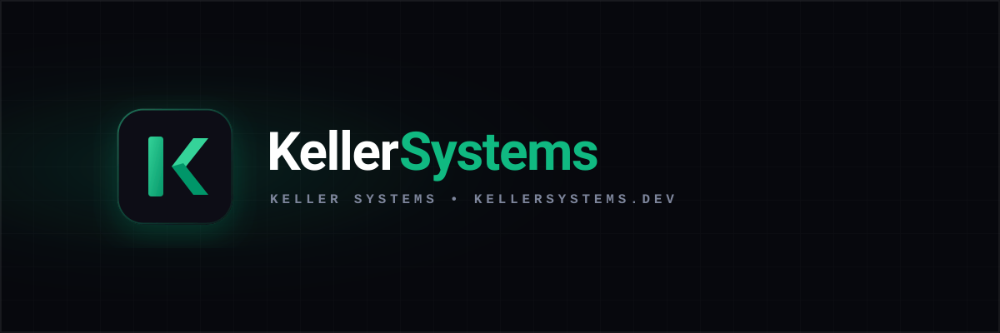

<div align="center">



<br>

[](https://kellersystems.dev)
[](https://kellersystems.dev#featured)
[](https://kellersystems.dev#all-work)
[](https://github.com/KELLERBABG)

<br>

[**Live Portal &rarr;**](https://kellersystems.dev) &bull; [**Featured Systems**](https://kellersystems.dev#featured) &bull; [**Repository Directory**](https://kellersystems.dev#all-work) &bull; [**GitHub Profile**](https://github.com/KELLERBABG)

</div>

---

## Overview

**Keller Systems** is an independent systems engineering and research portal focused on deterministic computation, cryptographic sovereignty, high-assurance embedded runtimes, and novel physical instrumentation.

Every system indexed here features dedicated domain routing. Selected systems are open source or source-available to encourage verification and community improvements, alongside dedicated commercial runtimes.

---

## Core Focus Areas

```
                     ┌──────────────────────────────┐
                     │        KELLER SYSTEMS        │
                     │      kellersystems.dev       │
                     └──────────────┬───────────────┘
                                    │
       ┌────────────────────────────┼────────────────────────────┐
       ▼                            ▼                            ▼
┌──────────────┐             ┌──────────────┐             ┌──────────────┐
│ Cryptography │             │  Aerospace   │             │ Deep Sensing │
│   & Proofs   │             │  & Hardware  │             │ & Harvesting │
├──────────────┤             ├──────────────┤             ├──────────────┤
│ • Post-quant │             │ • Micro-SAR  │             │ • Muon tomog │
│ • Dual-band  │             │ • Real-time  │             │ • Wildfire PM│
│   stego DSP  │             │   avionics   │             │ • Atmospheric│
│ • Zero-DRM   │             │ • Fault-tol. │             │   energy harv│
└──────────────┘             └──────────────┘             └──────────────┘
```

* **Deterministic Systems & Cryptography:** Audio steganography, zero-knowledge proofs, and post-quantum communication fabrics.
* **Aerospace & Physical Computing:** Low-Earth orbit micro-SAR payload controllers, radiation-tolerant telemetry kernels, and drone telemetry ledgers.
* **Deep Sensing & Harvesters:** Real-time atmospheric resonance harvesters, thermodynamic water generators, and environmental exposure trackers.

---

## Flagship Architectures

| System | Domain | Description | Stack | Live Subdomain | Repository |
| :--- | :--- | :--- | :--- | :--- | :--- |
| **Vantablack** | Cryptography & ZK | Post-quantum decentralized WAN mesh network with erasure-sharded onion routing | `Rust` `Tokio` `ML-KEM-768` | [vantablack.kellersystems.dev](https://vantablack.kellersystems.dev) | [Vantablack](https://github.com/KELLERBABG/Vantablack) |
| **BauLens** | Compliance & Civil | Deterministic German and EU building code compliance validation engine | `JavaScript` `TypeScript` `IFC` | [lens.kellersystems.dev](https://lens.kellersystems.dev) | [BauLens](https://github.com/KELLERBABG/BauLens) |
| **ClauseLens** | LegalTech & SMT | Automated contract clause contradiction and risk scoring engine | `JavaScript` `Deontic Logic` | [clause.kellersystems.dev](https://clause.kellersystems.dev) | [LexiClear](https://github.com/KELLERBABG/LexiClear) |
| **Ambient Thermal Arbitrage** | Thermodynamics & Energy | Ambient Thermal Arbitrage and virtual battery energy management system | `Rust` `Thermodynamics` `MPC` | [ambient.kellersystems.dev](https://ambient.kellersystems.dev) | [Ambient-Thermal-Arbitrage](https://github.com/KELLERBABG/Ambient-Thermal-Arbitrage) |
| **HoloForge** | Volumetric 3D Printing | Holographic tomographic volumetric 3D printing suite (Tomo-H-VAM) | `Python` `Wave Optics` | [holoforge.kellersystems.dev](https://holoforge.kellersystems.dev) | [HoloForge](https://github.com/KELLERBABG/HoloForge) |

---

## Complete Systems Directory (All 35 Projects)

### Commercial (`COMM` &middot; 6)

| System | What it does | Language | Live Deployment |
| :--- | :--- | :--- | :--- |
| **BauLens** | Checks a building plan against German, Austrian, and Swiss building codes before construction starts. | `JavaScript` | [lens.kellersystems.dev](https://lens.kellersystems.dev) |
| **ClauseLens** | Scans contracts offline for auto-renewal traps, one-sided liability clauses, and contradictions, then suggests cleaner wording. | `JavaScript` | [clause.kellersystems.dev](https://clause.kellersystems.dev) |
| **Ambient Thermal Arbitrage** | Uses the heating and cooling inertia of industrial buildings as a virtual battery to shift power use to cheaper hours. | `Rust` | [ambient.kellersystems.dev](https://ambient.kellersystems.dev) |
| **HoloForge** | Projects light from multiple angles into resin to cure a whole 3D-printed part at once, with a full laptop optical simulator. | `Python` | [holoforge.kellersystems.dev](https://holoforge.kellersystems.dev) |
| **Aureal Watermark** | Hides a subtle 32-bit ID inside audio tracks so you can trace ownership or recover provenance after edits and compression. | `HTML` | [aureal.kellersystems.dev](https://aureal.kellersystems.dev) |
| **TerraFlux** | Combines cheap soil moisture probes with weather forecasts and sends farmers one daily Telegram note on when and how long to irrigate. | `Python` | [terra.kellersystems.dev](https://terra.kellersystems.dev) |

### Open Source (`OS` &middot; 11)

| System | What it does | Language | Live Deployment | Source |
| :--- | :--- | :--- | :--- | :--- |
| **Vantablack** | Splits encrypted traffic into three shards across separate paths with post-quantum crypto so no relay or VPN sees the whole message. | `Rust` | [vantablack.kellersystems.dev](https://vantablack.kellersystems.dev) | [GitHub &rarr;](https://github.com/KELLERBABG/Vantablack) |
| **ABOS** | Software-defined radio fallback that bounces messages off the ionosphere when normal internet is not available. | `Rust` | [abos.kellersystems.dev](https://abos.kellersystems.dev) | [GitHub &rarr;](https://github.com/KELLERBABG/ABOS) |
| **AmtFlow** | Local assistant for German official letters &mdash; spots deadlines, translates bureaucracy into plain language, and drafts formal replies. | `JavaScript` | [amt.kellersystems.dev](https://amt.kellersystems.dev) | [GitHub &rarr;](https://github.com/KELLERBABG/AmtFlow) |
| **Differential Privacy Synthesizer** | Generates synthetic datasets that keep real statistical patterns while mathematically capping what anyone can learn about an individual. | `Python` | [dps.kellersystems.dev](https://dps.kellersystems.dev) | [GitHub &rarr;](https://github.com/KELLERBABG/Differential-Privacy-Synthesizer) |
| **Formal Verification** | Compile-time prover using Z3 that checks Rust code for memory, math, and logic bugs, with optional C, SQL, Lua, and Bash modules. | `Rust` | [veritas.kellersystems.dev](https://veritas.kellersystems.dev) | [GitHub &rarr;](https://github.com/KELLERBABG/Formal-Verification) |
| **KELLER-OS** | Bare-metal microkernel and hypervisor written from scratch for isolated, anti-forensic, post-quantum environments. | `Rust` | [kernel.kellersystems.dev](https://kernel.kellersystems.dev) | [GitHub &rarr;](https://github.com/KELLERBABG/KELLER-OS) |
| **MuonScope Tomography** | Simulates and reconstructs 3D scans from cosmic-ray muons &mdash; and shows why backpack-sized muon scanners hit a physics wall. | `Python` | [muon.kellersystems.dev](https://muon.kellersystems.dev) | [GitHub &rarr;](https://github.com/KELLERBABG/MuonScope-Tomography) |
| **PacePulse** | Research verifier that checks pacemaker pacing logic with Z3 to rule out unsafe states (verification tooling, not a medical device). | `Python` | [pulse.kellersystems.dev](https://pulse.kellersystems.dev) | [GitHub &rarr;](https://github.com/KELLERBABG/PacePulse) |
| **Quantum Entanglement Link** | Simulates a full quantum network stack, from noisy qubits and error correction up to QKD and repeater routing. | `Python` | [kellerbabg.github.io/QEL](https://kellerbabg.github.io/QEL/) | [GitHub &rarr;](https://github.com/KELLERBABG/QEL) |
| **SymEx EVM** | Runs Ethereum smart-contract bytecode symbolically with Z3 to surface vulnerabilities and concrete counter-examples. | `Rust` | [axiom.kellersystems.dev](https://axiom.kellersystems.dev) | [GitHub &rarr;](https://github.com/KELLERBABG/SymEx-EVM) |
| **TransitOS** | Formally verified safety gate between self-driving software and vehicle controls that blocks any command it cannot prove safe. | `Rust` | [transit.kellersystems.dev](https://transit.kellersystems.dev) | [GitHub &rarr;](https://github.com/KELLERBABG/TransitOS) |

### Proof of Concept (`PoC` &middot; 2)

| System | What it does | Language | Live Deployment | Source |
| :--- | :--- | :--- | :--- | :--- |
| **AeroResonance** | Tests whether atmospheric radio and acoustic resonance can harvest usable power, with a buildable hardware prototype and honest power math. | `Rust` | [resonance.kellersystems.dev](https://resonance.kellersystems.dev) | [GitHub &rarr;](https://github.com/KELLERBABG/AeroResonance) |
| **AeroDose** | Clip-on PM2.5 smoke tracker for outdoor crews that warns when a shift hits safe exposure limits and logs the dose. | `Rust` | [aero.kellersystems.dev](https://aero.kellersystems.dev) | [GitHub &rarr;](https://github.com/KELLERBABG/AeroDose) |

### Proof of Knowledge (`PoK` &middot; 6)

| System | What it does | Language | Live Deployment |
| :--- | :--- | :--- | :--- |
| **MycoSwarm** | Connects web browsers peer-to-peer to split up and verify WebAssembly compute tasks like a fungal network. | `TypeScript` | [bio.kellersystems.dev](https://bio.kellersystems.dev) |
| **OP-Roboter** | Real-time kinematics safety kernel that keeps surgical teleoperation robot arms inside safe motion bounds. | `Rust` | [kinematics.kellersystems.dev](https://kinematics.kellersystems.dev) |
| **PlaneOS** | Research prototype for formally verified flight-control logic and envelope protection (not certified avionics). | `Rust` | [plane.kellersystems.dev](https://plane.kellersystems.dev) |
| **Planetary Entropy Mining** | Turns measured physical noise into tamper-proof randomness certificates with a zero-knowledge proof hiding the sensor location. | `Python` | [pem.kellersystems.dev](https://pem.kellersystems.dev) |
| **SMPC Dark Pool** | Matches split trade orders across nodes with threshold cryptography so nobody sees the order book or can front-run trades. | `Rust` | [enclave.kellersystems.dev](https://enclave.kellersystems.dev) |
| **Zero Knowledge Genome** | Lets someone prove a genetic trait or sequence match cryptographically without sharing their raw DNA. | `Rust` | [zkg.kellersystems.dev](https://zkg.kellersystems.dev) |

### Archive (`ARCHIVE` &middot; 10)

| System | What it does | Language | Live Deployment |
| :--- | :--- | :--- | :--- |
| **Algorithmic Supply Chain Arbitrage** | Optimizes freight routing across shipping lanes using graph search and private price discovery. | `Rust` | [supply.kellersystems.dev](https://supply.kellersystems.dev) |
| **AquaMOF** | Passive solar panel concept coated in MOF-303 that pulls about a liter of drinking water a day out of dry desert air without electricity. | `Rust` | [aquamof.kellersystems.dev](https://aquamof.kellersystems.dev) |
| **AutoPoD** | Reconstructs vehicle crash physics from 10 kHz IMU sensors and seals the evidence in a tamper-proof Merkle log for claims. | `Rust` | [pod.kellersystems.dev](https://pod.kellersystems.dev) |
| **CityOS** | Local civic services and edge-computing layer built to run on top of the KELLER-OS microkernel. | `Rust` | [city.kellersystems.dev](https://city.kellersystems.dev) |
| **Decentralized Sovereign Credit Mesh** | Peer-to-peer credit clearing and risk settlement backed by zero-knowledge proofs and trust networks. | `Rust` | [credit.kellersystems.dev](https://credit.kellersystems.dev) |
| **FluidIP** | Protocol for tracking, licensing, and routing modular intellectual property and patent rights. | `Rust` | [patent.kellersystems.dev](https://patent.kellersystems.dev) |
| **Homomorphic Database** | Runs database aggregations and neural inference straight on encrypted data without decrypting it first. | `Rust` | [fhe.kellersystems.dev](https://fhe.kellersystems.dev) |
| **Smart Matter** | Research codebase for infrastructure-embedded sensors and programmable metamaterials. | `Rust` | [smart-matter.kellersystems.dev](https://smart-matter.kellersystems.dev) |
| **SybilGuard** | Zero-knowledge proof-of-personhood protocol that verifies unique humans without a central biometric database. | `Rust` | [citadel.kellersystems.dev](https://citadel.kellersystems.dev) |
| **TradeShield** | Retrofits commercial laundries with 20-micron microfiber filters, weighs what is caught, and issues verifiable removal credits. | `TypeScript` | [trade.kellersystems.dev](https://trade.kellersystems.dev) |

---

## Portal Architecture & Deployment

The portal is a lightweight, zero-dependency static application configured for high-availability edge delivery on Cloudflare Pages:

* **Static Core:** `index.html`, `data.js`, `script.js`, `style.css`
* **Edge Deployment:** Deployed via Cloudflare Pages with apex routing to `kellersystems.dev`
* **Real-Time Taxonomy:** Interactive search, domain tagging, and dynamic tier filtering (`COMM`, `OS`, `PoC`, `PoK`, `ARCHIVE`) without external libraries.

```bash
# Clone repository
git clone https://github.com/KELLERBABG/kellersystems-portal.git

# Serve locally
npx serve .
# or
python3 -m http.server 8080
```

---

<div align="center">
<sub>&copy; 2026 Keller Systems. Architectures, telemetry kernels, and systems research.</sub>
</div>
